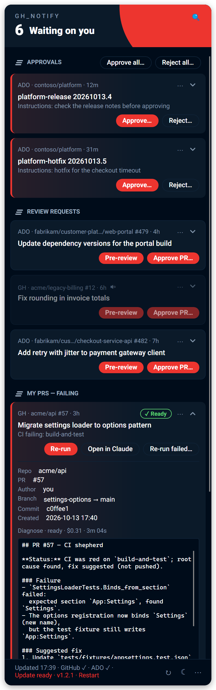
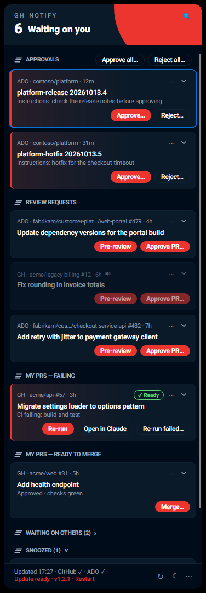
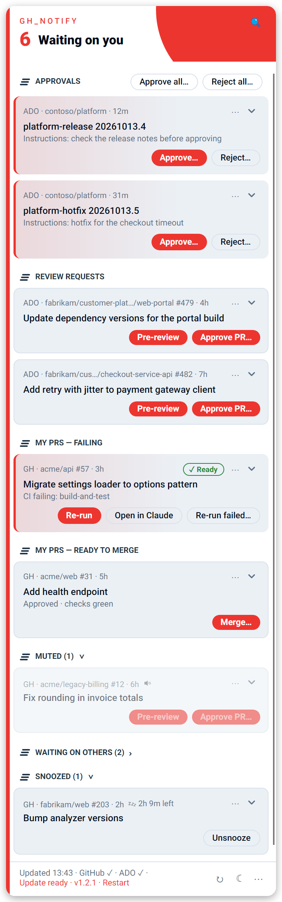
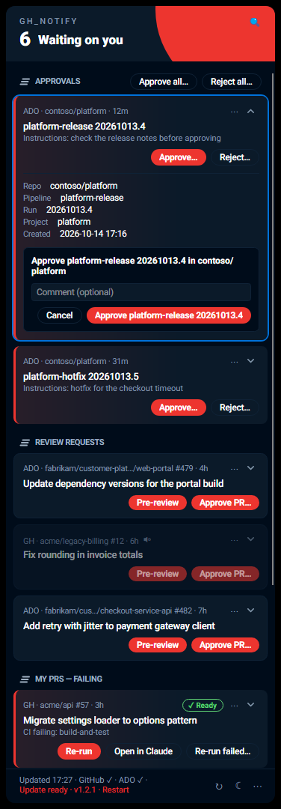
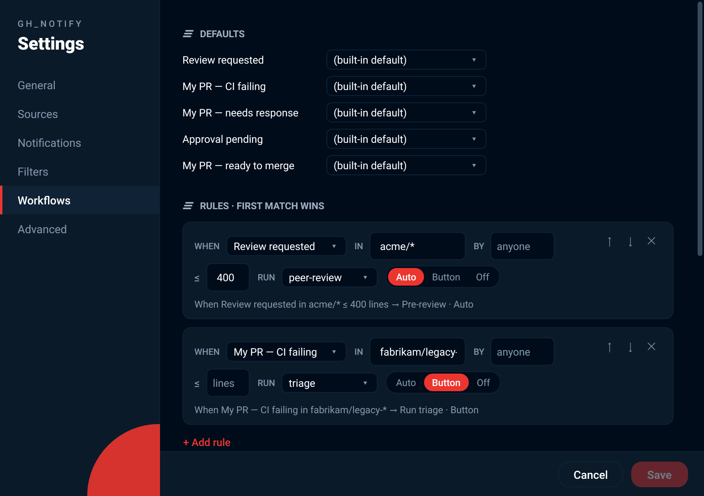
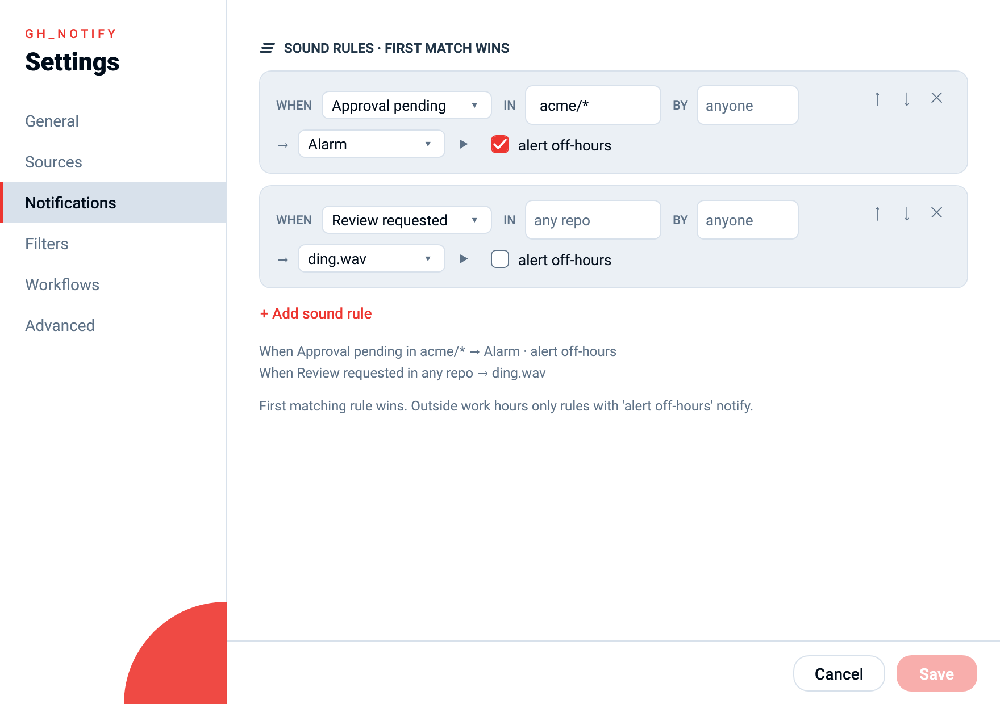

# gh_notify

A small Windows tray app that shows everything on GitHub and Azure DevOps that's waiting on you — and clears it the moment it isn't.

[](https://github.com/JoshHambright/gh_notify/actions/workflows/ci.yml)
[](https://github.com/JoshHambright/gh_notify/releases/latest)
[](https://github.com/JoshHambright/gh_notify/releases)
[](LICENSE)


## Install

**[⬇ Download GhNotify-win-Setup.exe](https://github.com/JoshHambright/gh_notify/releases/latest/download/GhNotify-win-Setup.exe)** — Windows 10/11, per-user, no admin rights. Updates install themselves.

**macOS 13 or later (Apple Silicon or Intel):** see [Install on macOS](docs/install-macos.md).

1. Run the installer. Windows SmartScreen may say "Windows protected your PC" because the build isn't code-signed yet: click **More info → Run anyway**.
2. Sign in to GitHub once: `gh auth login` (needs the [GitHub CLI](https://cli.github.com/)).
3. Optional, for Azure DevOps: `az login` (needs the [Azure CLI](https://aka.ms/installazurecliwindows)).

gh_notify starts in the system tray (click the ^ arrow if it's hidden) and launches with Windows. Click the icon to open your inbox.

<p align="center"></p>

| Dark | Light |
|---|---|
|  |  |

## What it watches

- review requests
- deployment and pipeline approvals
- your PRs failing CI
- your PRs needing a response
- your PRs ready to merge
- your other open PRs, as a quiet "Waiting on others" list

## Tour

### Two-step approvals

Approve or reject a deployment, pipeline approval or PR without leaving the tray. The first click checks the live state and
spells out exactly what will happen. The second click, on a button that names the target, sends it.



### Merge, re-run and batch approvals

- **Merge** your own ready PRs: clean merges only, you pick the method, and it is pinned to the commit you saw.
- **Re-run failed** jobs on CI-failing PRs (GitHub Actions), or re-queue failed build policies on Azure DevOps.
- **Batch approvals**: approve or reject every waiting approval with one confirm.
- **Keyboard first**: a global hotkey (default Win+Shift+G), arrow-key navigation, action keys and search.

See [docs/actions.md](docs/actions.md).

### Pre-review and diagnose agents

Claude Code agents can run unattended in a throwaway worktree: **Pre-review** reads a review request, **Diagnose** works out
why your PR is red. They are read-only, and a finished run shows **✓ Ready** with a one-line summary. Clicking its "ready"
notification resumes that Claude session in a terminal, so you can pick the review up straight away. The built-in
profiles need no skills; bring your own skills or scripts if you want. See [docs/workflows.md](docs/workflows.md).

### Sounds and off-hours alerts

Give any kind of item its own sound (five built-in tones or your own `.wav`). Outside work hours nothing toasts, unless a
sound rule says to alert off-hours, which is handy for approvals. One sound plays per poll, for the most important item.
See [docs/notifications.md](docs/notifications.md).

### Mute, hide and snooze

**Snooze** a single item until later, **mute** a repo, org or project (quiet, tucked into a collapsed **Muted** section), or
**hide** it entirely until you turn it back on. Everything is in the row's **⋯** menu:
- **Snooze** › 1 hour, 4 hours, Until tomorrow, Next week, Until it changes
- **Mute repo / org / project** › 1 hour, Until tomorrow, Forever
- **Hide repo / org / project**: one click, with **Undo** in the footer

The popup's own **⋯** menu lists active mutes (**Unmute**) and hidden patterns (**Unhide**, with how many items each hides).


### The settings window

Everything in `config.json` has a visual editor: sources, sound rules, filters, workflows and profiles, hooks.
Open it from the popup's **⋯** menu › **Settings…** (the tray icon has no right-click menu; the same menu has **Check for updates** and, once one is downloaded, **Restart to update**, next to the footer's **Update ready · Restart** link). Raw JSON stays one click away.





### Pull request numbers

PR rows and toasts show the number after the repo, for example `acme/api #57`, and the expanded row has a **PR** detail line.

### The calm / red tray icon

No red when nothing is waiting. A red sweep and a red count appear the moment something is.

| Nothing waiting | Something waiting |
|---|---|
|  |  |

## FAQ

**Why does Windows warn when I install it?**
The installer isn't code-signed yet, so SmartScreen shows "Windows protected your PC". Click **More info → Run anyway**.
Releases are built by CI from tagged source (versions come from conventional commits via release-please); see [docs/security.md](docs/security.md).

**Azure DevOps shows ✗ or an AADSTS error.**
Your default `az` account probably isn't the one Azure DevOps uses. Set the subscription in
**Settings › Sources › Test ADO sign-in**, which shows ✓ or the fix. See [docs/troubleshooting.md](docs/troubleshooting.md).

**An item didn't clear.**
Items clear on the next poll after the provider reports them done. **Refresh** (↻) forces a poll. GitHub's search index can lag
by about a minute after a merge or review.

**Is approving from the tray safe?**
Every action takes two steps, the state is re-checked live just before sending, and the confirm button is disabled for 600 ms
after it appears. If anything changed, it refuses. Details in [docs/security.md](docs/security.md).

**Can it merge for me?**
Yes, for your own PRs that are ready to merge. **Merge…** is two-step like approvals, only goes ahead when the PR is clean, never bypasses branch protection, and is pinned to the commit you saw. See [docs/actions.md](docs/actions.md#merge).

**What can the agents do?**
They are read-only: they can't comment, review, merge, push, commit or run pipelines. See [docs/security.md](docs/security.md).

**Where are my settings, logs and state?**
Config: `%APPDATA%\GhNotify\config.json`. State and logs: `%LocalAppData%\GhNotify-data`. The app itself is in
`%LocalAppData%\GhNotify`. **Settings › Advanced** has buttons that open each.

**How do I uninstall completely?**
Uninstall *GhNotify* from Windows **Apps & features**. That removes the app, shortcuts and the start-up entry, and keeps your
data. To remove that too, delete `%APPDATA%\GhNotify` and `%LocalAppData%\GhNotify-data`.

**Can I use my own skills or scripts?**
Yes. Map item kinds to your own profiles with `defaultProfiles`, or add rules. A profile is either a Claude prompt (which can
invoke your skills) or a command that runs any script. See [docs/workflows.md](docs/workflows.md).

**Toasts don't appear.**
Check Windows Focus Assist / Do Not Disturb. Also, toasts are off outside your work hours unless a sound rule sets
`alertOffHours`. See [docs/notifications.md](docs/notifications.md).

## Docs

- [Install on macOS](docs/install-macos.md): the .pkg, Open Anyway, notifications, uninstall
- [Configuration](docs/configuration.md): every `config.json` key, type and default
- [Workflows](docs/workflows.md): profiles, rules, command scripts, hooks
- [Actions and keyboard](docs/actions.md): approvals, merge, re-run, batch approvals, shortcuts, search
- [Notifications](docs/notifications.md): work hours, sounds, mute, hide, snooze
- [Security](docs/security.md): tokens, agent limits, approvals, updates
- [Troubleshooting](docs/troubleshooting.md)
- [Development](docs/development.md): build, test, quality gates, releases
- [Roadmap](docs/roadmap.md): what shipped and what is planned for v2.3 and v2.4

## Build from source

```powershell
dotnet build GhNotify.slnx -c Release
dotnet test GhNotify.slnx -c Release
dotnet run --project src/GhNotify.App
```

See [docs/development.md](docs/development.md).

## License

MIT — see [LICENSE](LICENSE). Bundled Roboto fonts are Apache-2.0 (see `src/GhNotify.App/Fonts/LICENSE.txt`).
