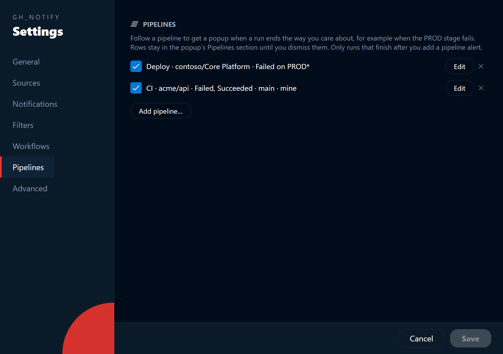

# gh_notify v2.3.0

Follow the pipelines you care about and get a popup when a run ends the way you want, such as the PROD stage failing.

## Highlights

- **Pipeline subscriptions:** Settings › Pipelines lets you follow an Azure DevOps pipeline or a GitHub Actions workflow and choose which outcomes alert you (Failed, Succeeded, Succeeded with issues), optionally only for matching stages or jobs, branches, or runs you triggered. [Learn more](../pipelines.md)

## New

- A **Pipelines** section in the popup. Rows stay until you dismiss them (**Dismiss**, the **D** key, or **Dismiss all**), and only failed rows count toward the tray badge.
- With stages set, the alert fires as soon as that stage finishes, even while the run is still going.
- `PipelineRun` is a new item kind for sound rules, mute and hide patterns.

## Changed

- Nothing changes for existing setups.

## Fixed

- Nothing in this release.

## Upgrade notes

Nothing to do. There are no pipeline subscriptions until you add one, and no new permissions are needed. The new `pipelineSubscriptions` key in `config.json` is documented in [Configuration](../configuration.md#pipelinesubscriptions).

## Learn more

- [Pipelines](../pipelines.md) · [Configuration](../configuration.md) · [Notifications](../notifications.md) · [Roadmap](../roadmap.md)
